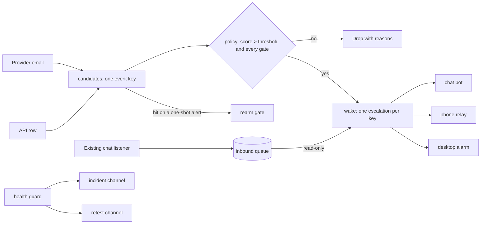
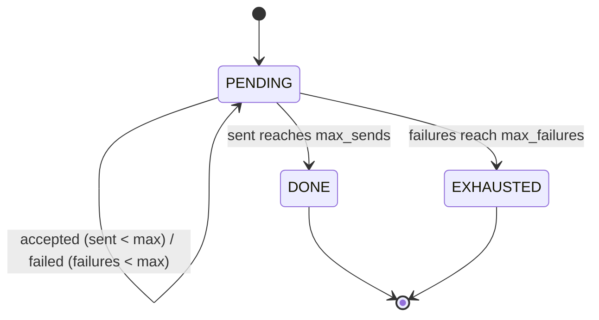
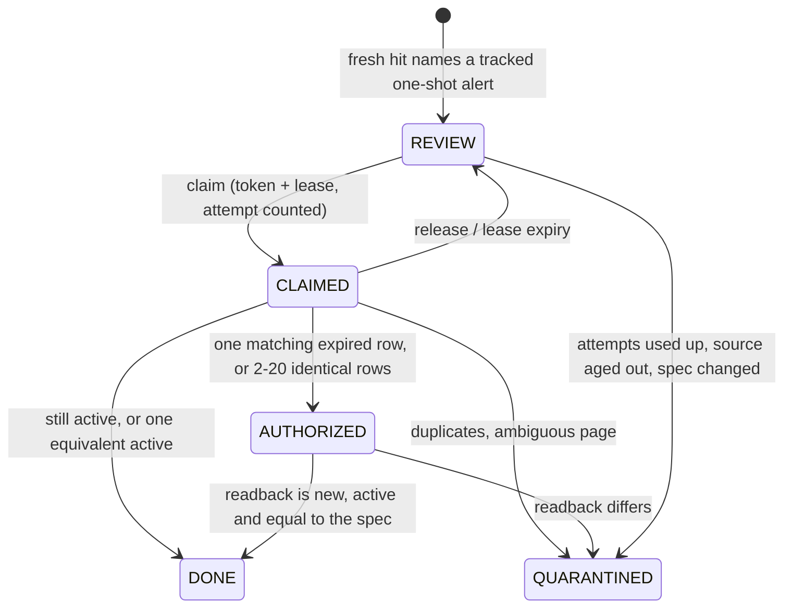

# Design notes

The bridge sits between providers that report scarce inventory and a person who has minutes to act. Every module answers one question and returns a decision; none of them talks to a provider, a mailbox or a chat service. That keeps the policy testable with an explicit clock and keeps every irreversible action out of reach.



## Candidates and identity

`event_key` hashes the fields that identify something bookable: kind, program, origin, destination, the ordered flight numbers (or property and room for a stay), dates and cabin. Price, fees, seat count, source, message id and alert group are deliberately left out. A price drop on the same seat is the same seat; two overlapping provider alerts matching one flight are one flight.

Mail parsing is strict in two directions. Mail that is not from an exact configured sender, or that has no `Points` line, returns `None`: newsletters and receipts are not alerts. Mail from the sender that looks like an alert but is malformed raises, so it shows up as a fault instead of reading as "nothing new". Duplicate fields in one body are refused rather than resolved by whichever came last.

`freshness` uses the provider's observation time, not when the mail arrived. A fresh export of old inventory is still old.

## Value policy

```
score = baseline_points * cabin_weight / points
```

The comparison is `exact_score > threshold`. The displayed score is rounded to two places afterwards. Rounding first would turn 2.500036 into 2.50 and fail a candidate that is above the threshold. A tie fails by design: the threshold is the price the operator has already said is not good enough.

Funding is a list of named pools per program. All of them must have a known balance; a missing or `null` balance stops evaluation with `balance_unknown` rather than being treated as zero or as enough. A stay needs points for every night. The policy reports every failed gate, not just the first, so a rejected candidate explains itself.

## Wake ledger

Each escalation has one record per channel with two counters, `sent` and `failures`, and two ceilings. They are separate on purpose. If failures counted against the send ceiling, a dead channel would use up its repeats without ever reaching anyone; if sends counted against the failure budget, a working channel would be cut off early.



An escalation closes as `CEILING` when every channel is `DONE` or `EXHAUSTED` and at least one send was accepted, or as `UNDELIVERED` when none was, which is the case a caller should page about through some other route. A closed key stays closed for the cooldown, so a provider that keeps re-sending the same seat does not restart the alarm.

### Acknowledgement

The chat provider gives each update to whichever client asks first. In the private system a second process that polled the same bot took replies away from the listener that was supposed to see them. Here the bridge never polls: the one listener appends to `InboundQueue`, and the bridge holds an `InboundReader`, which opens SQLite with `mode=ro` and has no method that consumes, deletes or marks anything.

The ledger reads the latest exact ACK before every send, not once per tick. An ACK closes every escalation whose first send was at or before the ACK. An escalation opened afterwards is a new event the operator has not seen, so it keeps going. ACK means seen. It is never read as approval for anything.

## Re-arm gate



The gate is event-gated: nothing happens because an alert disappeared from a listing. Pages fail to load, listings paginate, and a provider can pause an alert. Only a fresh hit that names the tracked alert proves it fired.

The expired-alerts page does not show ids. If a one-shot alert fired twice, two expired rows describe it, and the gate cannot tell which row belongs to which id. When every candidate row equals the frozen spec in every displayed field and the rows carry distinct markers, recreating from any of them is the same action, so it is allowed. A single displayed difference means the page is describing something else, and the request is quarantined for a person to look at. Quarantine produces one notice through `take_notices`, not one per run.

The completion check reads the replacement back and compares the whole spec, not just the fields that were typed. A replacement with wider caps is the most likely silent mistake, and it is exactly what the readback rejects.

## Health guard

Two kinds of fault, two channels:

| Kind | Example | Channel | Messages |
|---|---|---|---|
| `failure` | a source read failing, a channel exhausted, the scheduler not running | incident | one ⚠ at open, one ✅ after 30 minutes clear |
| `stale_evidence` | the last real phone-alarm test is older than its validity | retest | one 🟡 when due, another only for a newly due item, one 🟢 when all pass |

The split came from an incident: an aged physical test was folded into the same fault list as real failures and reported as a broken pipeline for about 32 hours. Nothing was broken. The operator needed a reminder to test, not an alarm.

Within an incident, faults may come and go without messages. When the last fault clears, the incident moves to `clearing`. A fault returning inside the settle window puts it back to `open` and counts a re-open; only an incident that stays clear for the full window sends ✅. Notice keys are deterministic so a sender can deliver idempotently.

## Irreversible-action boundary

The bridge can notify, open an official page and re-arm an alert. Each of those can be ignored or undone. It cannot book, hold, pay, transfer points, cancel or contact anyone, and those code paths do not exist here. `tests/test_boundary.py` parses every module and fails on a function or attribute named like one of those actions, and on any import that can reach the network (`socket`, `http`, `urllib.request`, `smtplib`, `subprocess` and similar). Every alert ends with the verification state, `Checkout: NOT REACHED`, and a statement that nothing was bought.

## Deliberate trade-offs

- Time is always passed in. A real deployment needs a clock source and a skew policy.
- State is local JSON and SQLite. The re-arm gate locks per operation; the wake ledger assumes one process.
- Transports report acceptance only. Hearing an alarm is verified by a physical test, tracked as evidence that ages.
- Quarantine is a stop, not a retry. A person decides what an ambiguous page means.
- Unknown is never upgraded: an unknown balance fails funding, an unrunnable health check changes nothing, an unknown action is refused.
